# Ghost Data Still Exists — Architecture

HackerRank Orchestrate, October 2026. This document describes how the Mastra-based deletion-audit agent is built, how
a request flows through it, and how to run it on your own machine.

Diagrams are written in [Mermaid](https://mermaid.js.org/) and render on GitHub and in most Markdown viewers.
Pre-rendered SVG copies are in [`docs/diagrams/`](./diagrams/).

---

## 1. What the system does

### Inputs and outputs

| | |
| --- | --- |
| **Input** | `dataset/deletion_requests.csv` (518 requests) plus identities, identity history, a global activity stream, deletion rules, and 94 evidence files (SQL snapshots, JSON, logs, text, PDFs, screenshots) |
| **Output** | `output.csv` at the repository root: `case_id,deletion_status,steps_json` |
| **Statuses** | `COMPLETE` (evidence proves every record is compliant), `INCOMPLETE` (something remains or can be recreated), `NOT_APPLICABLE` (the request does not authorize deletion) |
| **Steps** | ordered `FINDING` → `REMEDIATION` → `VERIFICATION` objects, each naming a system, resource, operation, target state and the evidence item that proves it |

### Design principles

1. **Evidence over claims.** Workflow statuses (`reported_status`) and activity results (`SUCCESS`, `PARTIAL`, ...) are
   claims. Record state is taken from snapshots, lookups, logs, screenshots and documents.
2. **Point in time.** A case is judged at its `audit_at`. Only evidence items captured by then can establish state or be
   cited.
3. **Deterministic core, agentic edges.** Decisions are made by a deterministic engine so the 518-row output is
   reproducible. Mastra LLM agents handle language and vision (intent, screenshots/PDFs, review) when a provider key is
   configured, and fall back to rule-based counterparts when it is not.
4. **Policy from data.** Treatments come from `dataset/deletion_rules.csv`, not from code constants.

---

## 2. Architecture diagram

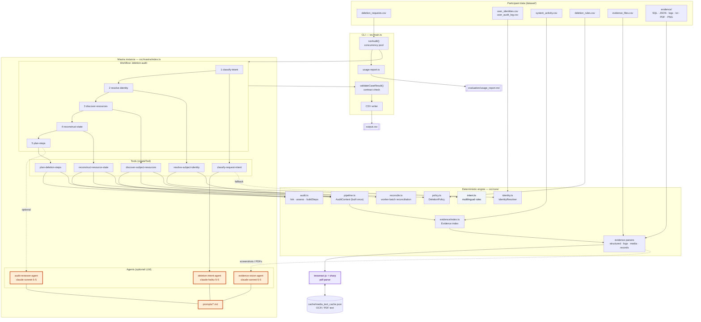

**Legend:** orange boxes with a thick border are **LLM agents** (Mastra `Agent`, optional, switched on by an API
key). The purple box is **machine-learning OCR** (tesseract.js LSTM model, always on, runs locally). The dashed grey
box is the **rule-based fallback** used when no LLM is configured. Everything else is deterministic TypeScript.

### Components

| Component | File(s) | Responsibility |
| --- | --- | --- |
| CLI | `src/main.ts` | Loads requests, runs the Mastra workflow for each one (pool of 8), validates every row, writes `output.csv`, regenerates the usage report |
| Mastra instance | `src/mastra/index.ts` | Registers the three agents and the `deletion-audit` workflow |
| Workflow | `src/mastra/workflows/deletion-audit-workflow.ts` | Five `createStep` steps chained with `.then()`; non-deletion requests short-circuit to `NOT_APPLICABLE` |
| Tools | `src/mastra/tools/audit-tools.ts` | One `createTool` per audit stage, with zod input/output schemas; reusable by any Mastra agent |
| Agents | `src/mastra/agents/index.ts`, `src/mastra/prompts/*.md` | Intent classifier, screenshot/PDF reader, reviewer; structured output via zod; every call metered |
| LLM config and metering | `src/mastra/llm.ts` | Model selection from environment, enable/disable logic, token and cost accounting |
| Audit context | `src/core/pipeline.ts` | Builds the dataset, evidence index, identity resolver, policy and auditor once per process |
| Evidence index | `src/core/evidence/index.ts` | Parses all 94 files and the activity stream into normalised **observations** and **snapshot scopes** |
| Parsers | `src/core/evidence/structured.ts`, `logs.ts`, `media.ts`, `records.ts` | SQL (executed with `node:sqlite`), JSON bundles / exports / record lists, handover text, six log dialects with trace correlation, PDF text, OCR of screenshots |
| Identity | `src/core/identity.ts` | Maps a request email (current or historical) to a user and collects every email, phone, hash and `user_id` the person ever had |
| Intent rules | `src/core/intent.ts` | Multilingual deletion vocabulary and explicit "do not delete" negations (en, es, pt, fr, de, ko, ja, zh) |
| Auditor | `src/core/audit.ts` | Links records to the subject, reconstructs state at `audit_at`, builds and orders steps |
| Batch reconciliation | `src/core/reconcile.ts` | Attributes records that carry no identifier (404 profile lookups, anonymised analytics) via the deletion-worker batch around `reported_at` |
| Policy | `src/core/policy.ts` | Category → treatment from `deletion_rules.csv`; treatment + state → finding / remediation / verification |
| Validator | `src/core/validate.ts` | Output contract: statuses, step numbering, allowed operation/state pairs, ordering, citation rules |

---

## 2A. Where AI and LLMs are used

### 2A.1 AI touch points

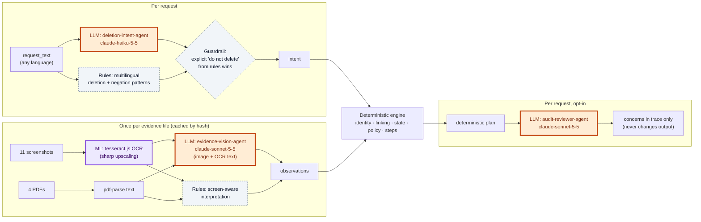

### 2A.2 Summary table

| # | Where | Technique | Model (default) | Used for the submitted `output.csv`? | Fallback |
| --- | --- | --- | --- | --- | --- |
| 1 | Workflow step `classify-intent` → tool `classify-request-intent` → `deletion-intent-agent` | LLM, structured output (zod), temperature 0 | `anthropic/claude-haiku-5-5` | **No**: no API key was available in the build environment | multilingual rules in `src/core/intent.ts` |
| 2 | Evidence index → `evidence-vision-agent` for screenshots and PDFs | multimodal LLM (image + OCR text), structured output | `anthropic/claude-sonnet-5-5` | **No**: same reason | OCR + screen-aware rules in `src/core/evidence/media.ts` |
| 3 | Workflow step `plan-steps` → `audit-reviewer-agent` | LLM critique of the finished plan | `anthropic/claude-sonnet-5-5` | No: opt-in (`AUDIT_LLM_REVIEW=1`) | none needed; it only annotates the trace |
| 4 | Screenshot text extraction | ML OCR (tesseract.js LSTM, English model shipped as an npm package) | `@tesseract.js-data/eng` 4.0.0_best_int | **Yes**: all 11 screenshots (text cached in `cache/media_text_cache.json`) | — |
| 5 | Development of the solution | Claude Code, plus a 10-agent verification workflow that independently re-derived 17 hard cases | Claude (session model) | Shaped the rules; not part of the runtime | — |

Why the LLMs sit at the edges and not in the decision core: the grader compares exact resource ids, operations,
evidence ids and order. A deterministic engine makes those reproducible and auditable. The LLMs add value where the
input is unstructured (free-text requests in many languages, screenshots, documents). There, their structured
output feeds the same engine.

### 2A.3 Turning the LLM agents on

The agents are already implemented and registered in the Mastra instance. They switch on automatically when a
provider key is present.

1. **Verify the wiring without a key** (uses Mastra's mock language model through the production code paths):

   ```bash
   npm run llm-smoke
   ```

   You should see `source=llm+rules` for intent, an `llm-vision` observation for the connector screenshot, and
   metered usage for `mock/intent-mock-model` and `mock/vision-mock-model`.

2. **Add your key** to the environment (never commit it; `code/.env` is git-ignored):

   ```bash
   export ANTHROPIC_API_KEY=your-key-here
   ```

3. **Optional: pick models** (any Mastra model-router id, e.g. `openai/gpt-5-mini` with `OPENAI_API_KEY`):

   ```bash
   export AUDIT_INTENT_MODEL=anthropic/claude-haiku-5-5
   ```

4. **Run the audit**:

   ```bash
   npm start
   ```

   `evaluation/usage_report.md` now lists real calls, input/output tokens and estimated cost per model.

5. **Compare against the deterministic baseline**:

   ```bash
   npm run evaluate
   ```

   Set `AUDIT_LLM=off` for a run without the LLM agents.

6. **Optional reviewer**: `export AUDIT_LLM_REVIEW=1` adds per-case concerns to the trace (`--trace` flag).

### 2A.4 Adding a new LLM agent

Example: an agent that breaks ties when several identifier-less records compete in the same deletion-worker batch.

1. **Prompt**: write `src/mastra/prompts/<name>.md` (role, inputs, the exact output fields).
2. **Agent**: in `src/mastra/agents/index.ts`, create
   `new Agent({ id, name, instructions: prompt('<name>'), model: () => resolveModel('<role>') })`. Add the role to
   `AgentRole`, `DEFAULT_MODELS` and the environment mapping in `src/mastra/llm.ts`.
3. **Schema and call**: define a zod schema. Call `agent.generate(input, { structuredOutput: { schema }, modelSettings: { temperature: 0 } })`,
   then record `res.totalUsage` with `usageTracker.record(...)`. Wrap the call in `try/catch` and return `null` so the
   deterministic path takes over on any failure.
4. **Use it from a tool or step**: call it inside the relevant `createTool` (`src/mastra/tools/audit-tools.ts`) or
   workflow step, guarded by `llmEnabled('<role>')`.
5. **Register**: add the agent to `new Mastra({ agents: { ... } })` in `src/mastra/index.ts`.
6. **Test**: extend `src/scripts/llm-smoke.ts` with a mock response, then run `npm run evaluate` with a real key to
   confirm the samples and custom cases do not regress.

---

## 3. Data flow diagram

### 3.1 Context level

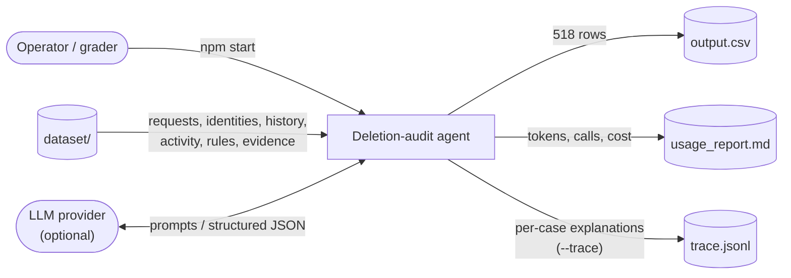

### 3.2 Level 1 — processing stages and data stores

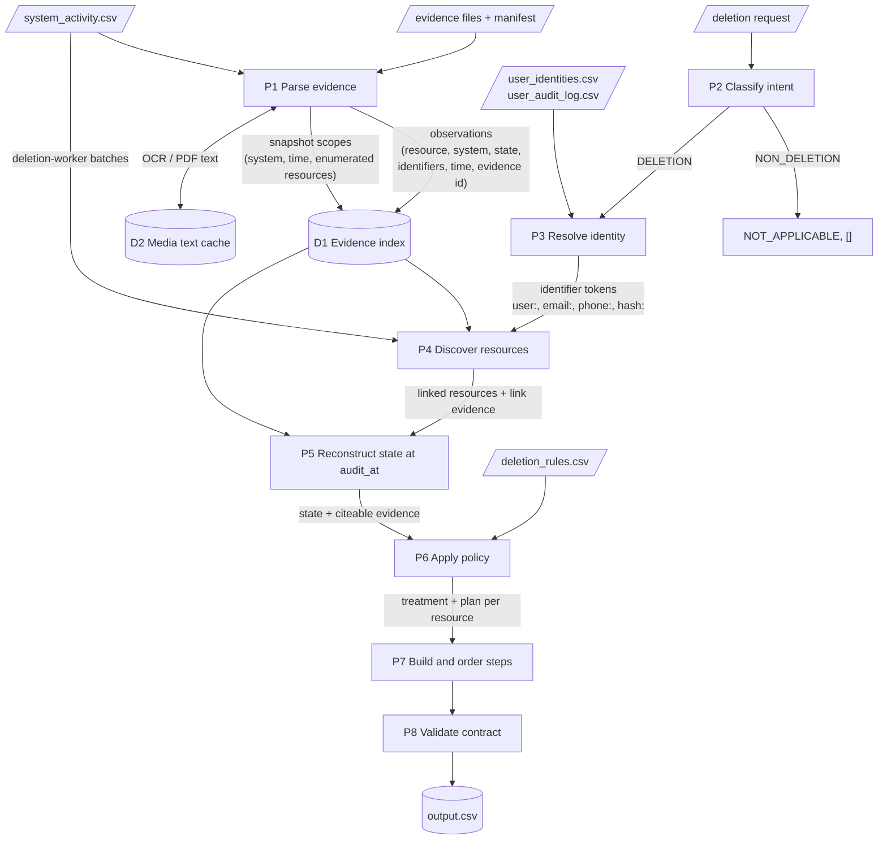

### 3.3 What each stage reads and writes

| Stage | Reads | Writes | Key rules |
| --- | --- | --- | --- |
| P1 Parse evidence | manifest, 94 files, activity | observations, snapshot scopes, OCR cache | activities are **claims** except explicit checks (`CHECK_DATA_FLOW`, `CHECK_RESTORE_ACCESS`, `RESTORE_BACKUP`) and catalog links (`LINK_RESOURCE_IDENTITY`) |
| P2 Classify intent | `request_text` | intent, request type | explicit "do not delete" wins over deletion vocabulary; LLM agent decides when configured |
| P3 Resolve identity | request email, identities, audit log | identifier tokens | the request email may be historical; all historical emails, phones and hashes are kept |
| P4 Discover resources | tokens, observations, activity | linked resources | exact identifier match (look-alikes such as `name.jr@` never match), trace-id correlation in logs, catalog links, source-record references both ways, batch reconciliation; linking evidence must be dated ≤ `audit_at` (later readbacks only if the person has no later request) |
| P5 Reconstruct state | observations, scopes | state + evidence id per resource | only post-request evidence from files captured ≤ `audit_at`; a copy in any replica counts as present; an enumerating snapshot proves absence only for records with no explicit post-request sighting |
| P6 Apply policy | rules, category, state | treatment and step plan | DELETE / REDACT / ANONYMIZE / RETAIN / BLOCK_RESTORE / DISABLE_FLOW |
| P7 Build steps | plans | ordered steps | findings → remediation → verification; within a phase by operation order, then `system_id`, then `resource_id` |
| P8 Validate | steps, manifest, activity, audit log | pass / problems | cited ids exist and were captured ≤ `audit_at`; future work has `evidence_id: ""` |

### 3.4 Core data model

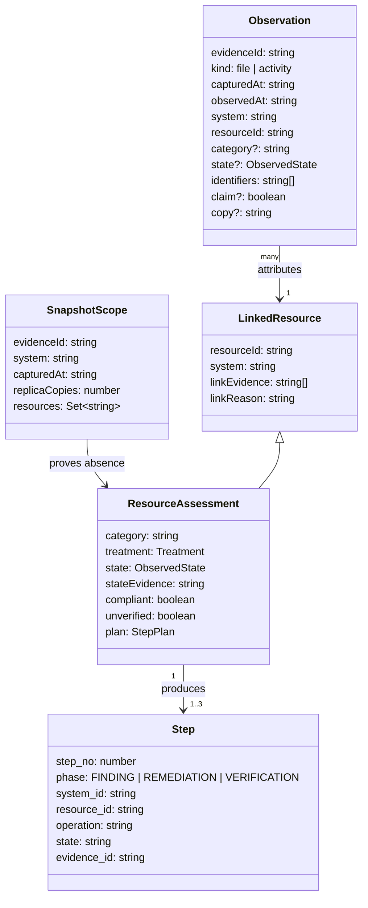

`ObservedState` is one of `PRESENT`, `ABSENT`, `IDENTIFIABLE`, `ANONYMIZED`, `REDACTED`, `ACTIVE`, `DISABLED`,
`RESTORABLE`, `BLOCKED`.

### 3.5 Policy mapping

| Category (from evidence) | Rule | Treatment | Non-compliant state → finding | Verification |
| --- | --- | --- | --- | --- |
| `USER_PROFILE`, `SEARCH_INDEX_ENTRY`, `CACHE_ENTRY`, `USER_EXPORT`, `MARKETING_PROFILE`, `SUPPORT_ATTACHMENT` | rule_01/03/04/09/10/06 | DELETE | present → `REPORT_REMAINING_RECORD` | `VERIFY_RECORD_ABSENT` |
| `SUPPORT_MESSAGE` (shared order/agent context) | rule_05 | REDACT | identifiable → `REPORT_EXPOSED_PII` | `VERIFY_RECORD_REDACTED` |
| support contact copy without shared context | rule_05 condition not met | DELETE | present → `REPORT_REMAINING_RECORD` | `VERIFY_RECORD_ABSENT` |
| `ANALYTICS_PROFILE`, `PRODUCT_TELEMETRY` | rule_07/08 | ANONYMIZE | identifiable → `REPORT_EXPOSED_PII` | `VERIFY_RECORD_ANONYMIZED` |
| `EMAIL_DELIVERY_LOG` | rule_11 | REDACT | identifiable → `REPORT_EXPOSED_PII` | `VERIFY_RECORD_REDACTED` |
| `SECURITY_AUDIT_LOG` (in retention), `LEGAL_HOLD_RECORD` (hold active) | rule_12/13 | RETAIN | — | `VERIFY_RECORD_PRESENT` |
| `BACKUP_ARCHIVE` | rule_14 | retain + block restore | restorable → `REPORT_RESTORE_RISK` | `VERIFY_RESTORE_BLOCKED` |
| `ACCOUNT_TOMBSTONE` | rule_15 | REDACT (keep stable `user_id`) | name/email/phone/hash present → `REPORT_EXPOSED_PII` | `VERIFY_RECORD_REDACTED` |
| integration data flow | no-recreation principle | DISABLE | enabled → `REPORT_ACTIVE_DATA_FLOW` | `VERIFY_DATA_FLOW_DISABLED` |

---

## 4. Sequence diagrams

### 4.1 Full run (`npm start`)

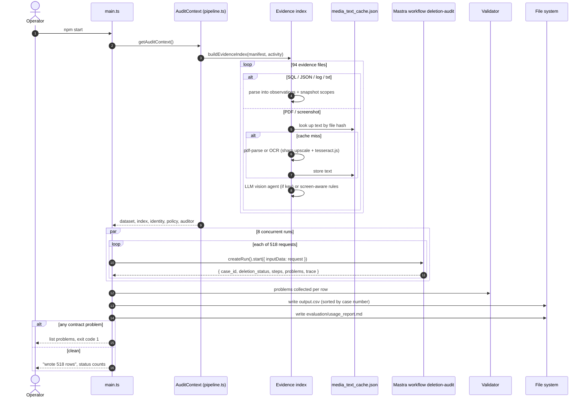

### 4.2 One request through the workflow

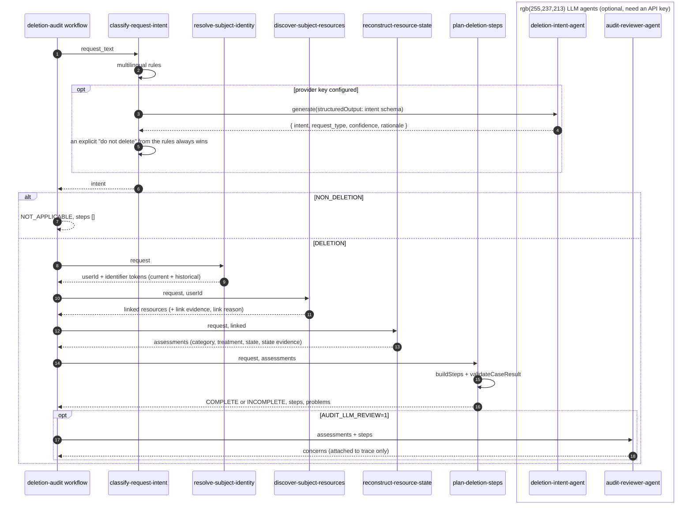

### 4.3 Scenario — request that does not authorize deletion

Example: *"Please remove me from marketing lists only. I still want receipts and service messages."*

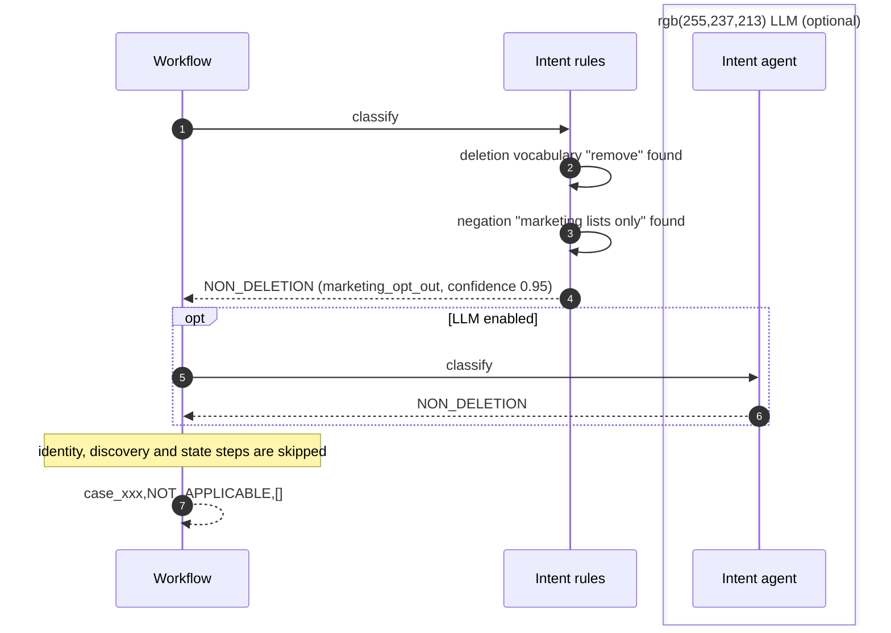

### 4.4 Scenario — deletion verified complete (account tombstone)

Example: the account is gone, the deleted-account reference keeps only `user_id`, and the security audit record is
retained.

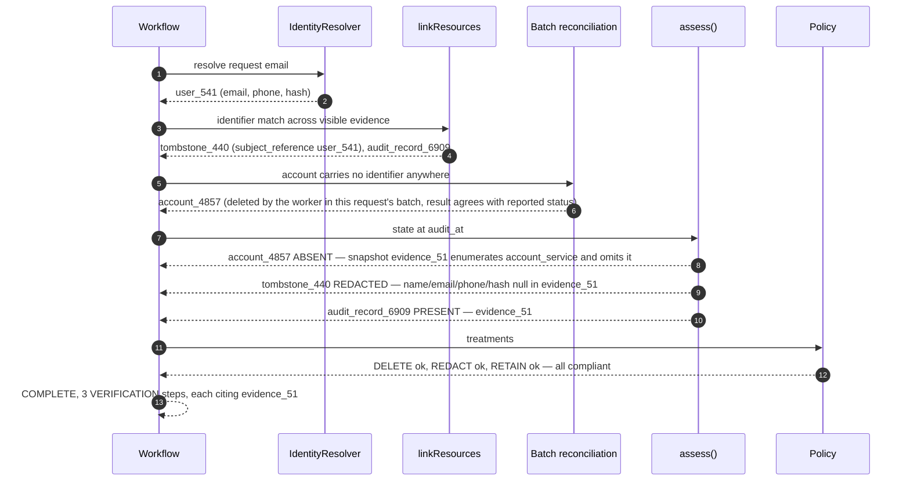

### 4.5 Scenario — incomplete: active sync, open restore path, remaining search document

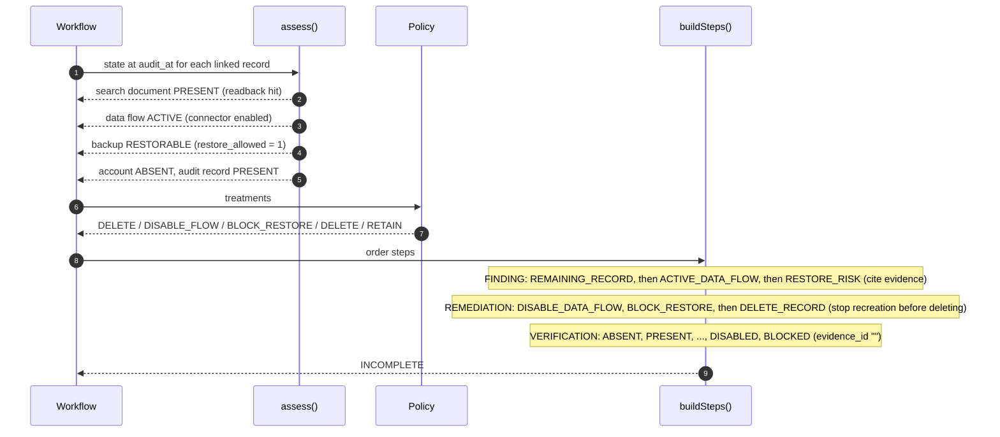

### 4.6 Scenario — replication drift and claims that contradict evidence

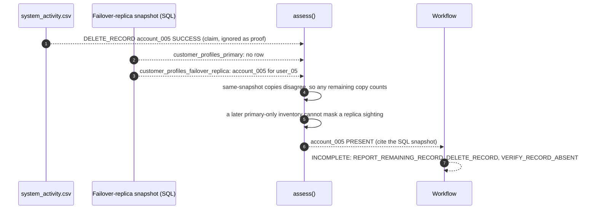

### 4.7 Scenario — historical identifier and point-in-time cut-off

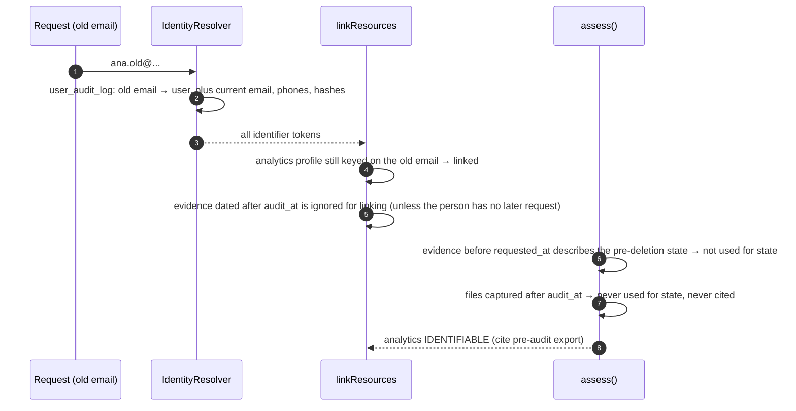

### 4.8 Scenario — screenshot and PDF evidence

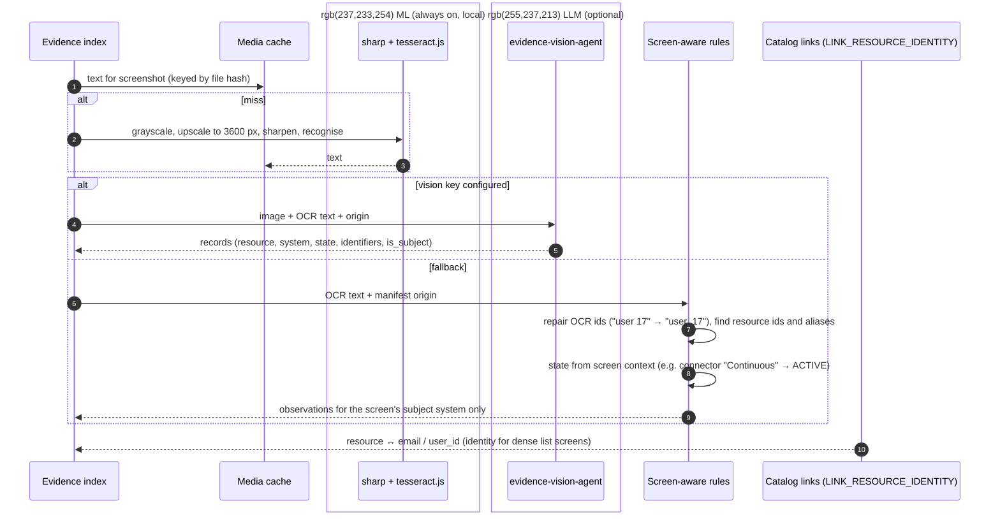

### 4.9 Scenario — identifier-less records (worker-batch reconciliation)

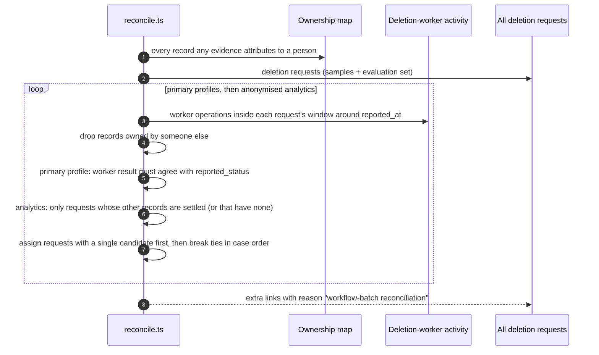

---

## 5. Running it locally

### 5.1 Prerequisites

| Requirement | Version | Notes |
| --- | --- | --- |
| Node.js | **22.13 or newer** | the built-in `node:sqlite` module executes the SQL snapshots; check with `node --version` |
| npm | bundled with Node | all dependencies come from the npm registry |
| git | any | to clone the repository |
| OS | macOS, Linux or Windows | `sharp` installs a prebuilt binary for each platform |

No Python, database server, Docker or API key is required.

### 5.2 Get the code and install

```bash
git clone https://github.com/rtnsht/hackerrank-orchestrate-october26.git
```

```bash
cd hackerrank-orchestrate-october26
```

```bash
git checkout freshbuild-mastraai-101
```

```bash
cd code
```

```bash
npm install
```

The `dataset/` folder must sit next to `code/` (it does in the repository). To point at another copy, set
`DATASET_DIR=/path/to/dataset`.

### 5.3 Produce `output.csv`

```bash
npm start
```

Expected console output (timings vary):

```text
auditing 518 requests with the Mastra deletion-audit workflow...
wrote 518 rows to <repo>/output.csv in 5.0s { INCOMPLETE: 348, COMPLETE: 160, NOT_APPLICABLE: 10 }
updated evaluation/usage_report.md
```

- `output.csv` is written at the repository root.
- The command exits with code 1 and lists the problems if any row breaks the output contract.
- OCR text for the 11 screenshots is cached in `code/cache/media_text_cache.json`. Delete that file to force
  re-OCR, which adds about 30 seconds.

### 5.4 Other commands

| Command (inside `code/`) | Result |
| --- | --- |
| `npm run samples` | runs the 32 public sample requests; predictions go to `code/.runs/sample_predictions.csv` |
| `npm run evaluate` | scores the samples against `dataset/sample_output.csv` and the 8 participant-created cases, and rewrites the metrics block of `evaluation/evaluation_report.md` |
| `npm start -- --trace .runs/trace.jsonl` | also writes one JSON line per case explaining linked records, link evidence, state evidence and the rule applied |
| `npm start -- --input <file.csv> --output <out.csv>` | audits any CSV with the request columns |
| `npm run typecheck` | `tsc --noEmit` over the whole project |

### 5.5 Optional: switch on the LLM agents

Create an uncommitted `code/.env` (already ignored by git) or export variables in your shell. Keys are read from the
environment only.

```bash
export ANTHROPIC_API_KEY=your-key-here
```

```bash
npm start
```

| Variable | Default | Effect |
| --- | --- | --- |
| `ANTHROPIC_API_KEY` / `OPENAI_API_KEY` / … | unset | enables the agents for that provider |
| `AUDIT_MODEL` | — | one Mastra model id for every agent |
| `AUDIT_INTENT_MODEL` | `anthropic/claude-haiku-5-5` | intent agent |
| `AUDIT_VISION_MODEL` | `anthropic/claude-sonnet-5-5` | screenshot / PDF agent |
| `AUDIT_REVIEW_MODEL` | `anthropic/claude-sonnet-5-5` | reviewer agent |
| `AUDIT_LLM` | `auto` | `off` forces the deterministic path |
| `AUDIT_LLM_VISION` | `1` | `0` keeps OCR rules for media |
| `AUDIT_LLM_REVIEW` | unset | `1` runs the reviewer; notes go to the trace only |

With agents on, `evaluation/usage_report.md` records real calls, tokens and estimated cost per model.

### 5.6 Windows notes

- Use PowerShell. `npm install`, `npm start`, `npm run samples` and `npm run evaluate` work the same way.
- Set variables with `$env:ANTHROPIC_API_KEY = "your-key-here"` instead of `export`.
- Package with `Compress-Archive` as described in the root `README.md`.

### 5.7 Troubleshooting

| Symptom | Fix |
| --- | --- |
| `No such built-in module: node:sqlite` | upgrade Node.js to 22.13 or newer |
| `sharp` fails to install | delete `node_modules`, run `npm install` again on the same machine that will run the code |
| OCR text differs on another machine | keep the shipped `cache/media_text_cache.json`; it is keyed by file hash, so it is reused as long as the screenshots are unchanged |
| `wrote 0 rows` / file not found | run the commands from `code/`, with `dataset/` next to it, or set `DATASET_DIR` |

---

## 6. Repository layout

```text
hackerrank-orchestrate-october26/
├── README.md                     solution overview, quick start, packaging
├── AGENTS.md / problem_statement.md
├── output.csv                    final predictions (generated)
├── log.txt                       agent chat transcript
├── dataset/                      participant data (not packaged)
└── code/
    ├── package.json, tsconfig.json
    ├── docs/ARCHITECTURE.md      this document (+ diagrams/*.svg)
    ├── cache/media_text_cache.json
    ├── src/
    │   ├── main.ts               CLI
    │   ├── mastra/               index.ts, agents/, tools/, workflows/, prompts/, llm.ts
    │   ├── core/                 pipeline, identity, intent, audit, reconcile, policy, validate, evidence/
    │   ├── report/usage-report.ts
    │   └── scripts/              debugging helpers (dump cases, quick sample scoring, stats)
    └── evaluation/
        ├── evaluate.ts, score.ts, custom-cases.ts
        ├── evaluation_report.md
        └── usage_report.md
```
